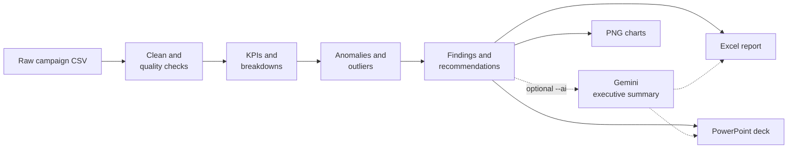
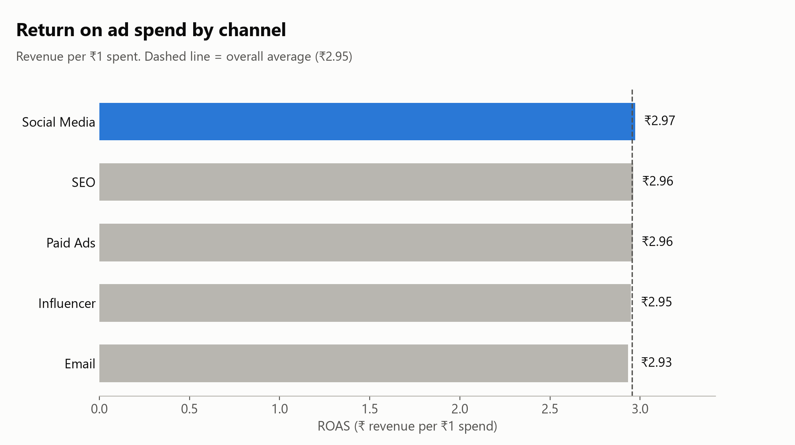
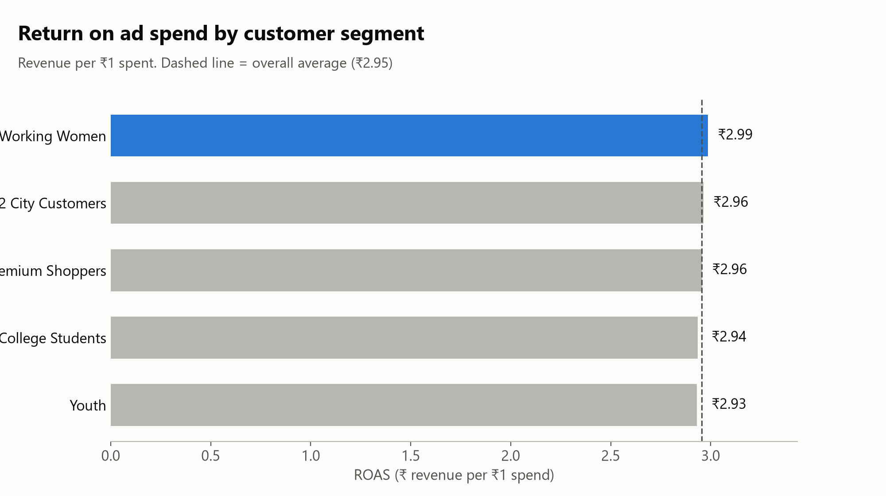
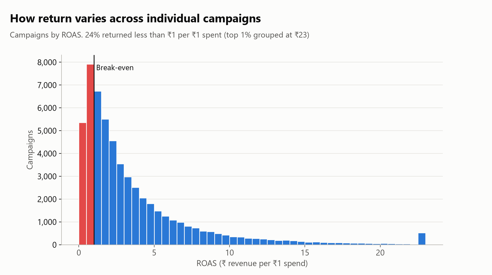
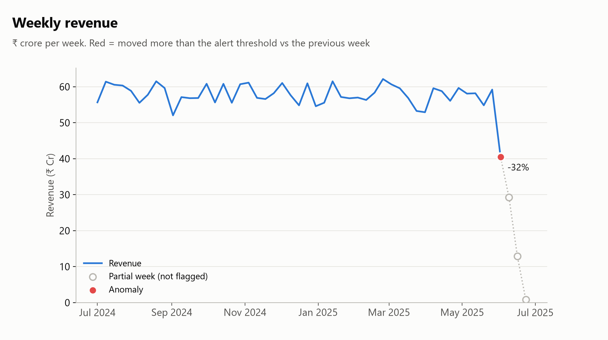

# Digital Performance Reporter

Turns a raw marketing campaign export into a finished weekly performance report (an Excel workbook, a PowerPoint deck and web-ready charts) with one command.

```
python run_report.py --input data/raw/nykaa_campaign_data.csv
```

## The problem

Marketing and digital teams rebuild the same performance report by hand every week: export the data, clean it in a spreadsheet, recalculate CTR and ROI, copy charts into slides and write the commentary. It takes hours, the numbers drift between versions and nobody has time left to look at what changed.

This tool automates that whole loop. The data goes in, a consistent report comes out, and the commentary is written from the numbers by simple rules, so the analyst's time goes on the "so what".

## What it does

| Step | What happens |
|---|---|
| **Config** | `config.yaml` maps the dataset's column names to standard names. A different dataset only needs a new mapping, no code changes. |
| **Clean** | Checks for missing values, duplicates and impossible values (clicks > impressions, negative spend, conversion rate outside 0-100%, conversions > clicks). Bad rows are removed or flagged, and the reported ROI is cross-checked against revenue and spend. Prints a data-quality summary. |
| **KPIs** | CTR, conversion rate, cost per click, cost per conversion, revenue, ROI and ROAS, broken down by channel, customer segment, campaign length, platform and campaign. Group figures come from totals, not averages of ratios. |
| **Anomalies** | Weekly trend with week-on-week moves above 20% flagged (partial weeks are excluded). Campaigns more than 3 standard deviations from their channel's average ROI or cost per conversion are flagged as outliers. |
| **Insights** | 4-6 plain-English findings and recommendations, written by simple rules from the KPI tables. If the gap between the best and worst group is under 5%, the wording says so instead of overselling a winner. |
| **AI summary (optional)** | `--ai` sends the findings to Gemini for a short executive summary. The report works fully without it. |
| **Outputs** | Excel report with KPI cards, native charts, number formatting and red highlighting for weak performers; 8-slide PowerPoint where every title states the finding; PNG charts for a website. |



## How to run it

Requires Python 3.10+.

```bash
python -m venv .venv
.venv\Scripts\activate          # Windows
# source .venv/bin/activate     # macOS / Linux
pip install -r requirements.txt
```

Download the dataset (see [Dataset](#dataset)) and put `nykaa_campaign_data.csv` in `data/raw/`, then:

```bash
python run_report.py --input data/raw/nykaa_campaign_data.csv
```

Outputs land in `output/`:

```
output/
├── report_<date>.xlsx
├── report_<date>.pptx
└── charts/*.png
```

Options:

| Flag | Default | |
|---|---|---|
| `--input` | (required) | campaign CSV |
| `--config` | `config.yaml` | column mapping and thresholds |
| `--output` | `output` | where to write the report |
| `--ai` | off | add a Gemini executive summary |

To use `--ai`, set the API key as an environment variable first (it is never written to a file):

```powershell
$env:GEMINI_API_KEY = "your-key"       # PowerShell
python run_report.py --input data/raw/nykaa_campaign_data.csv --ai
```

If the key is missing or the request fails, the report still completes without the summary.

Run the tests:

```bash
python -m pytest
```

### Using a different dataset

Edit the right-hand side of `columns:` in `config.yaml`. The essentials are campaign, channel, impressions, clicks and revenue, plus either `spend` or `cost_per_conversion`, and either `conversions` or `conversion_rate`. Segment, platform, duration and date are optional; the report skips the sections it has no data for (for example, no date column means no weekly trend). Thresholds such as the 20% week-on-week alert live in the same file.

## Sample output

From the full dataset (55,555 campaigns, Jul 2024 to Jun 2025):

```
[3/5] KPIs: revenue ₹2,865.6 Cr, spend ₹969.9 Cr, ROAS 2.95x, ROI 195%, CTR 8.51%
[4/5] Findings
  1. Social Media is the best channel for return on spend (₹2.97 back per ₹1), but channels
     are close: the weakest, Email, is only 1.4% behind at ₹2.93.
  2. Working Women is the best segment for return on spend (₹2.99 back per ₹1), but segments
     are close: the weakest, Youth, is only 1.9% behind at ₹2.93.
  3. 24% of campaigns (13,276) lost money: they used 29% of total spend (₹280.2 Cr) and
     brought back ₹156.9 Cr.
  ...
```

The headline: channels and segments perform almost identically, but individual campaigns range from losing almost everything to returning ₹75 per ₹1. The biggest lever is fixing weak campaigns, not moving budget between channels.

| | |
|---|---|
|  |  |
|  |  |

**Excel sheets:** Summary, By Channel, By Segment, By Duration, By Platform, By Campaign (top and bottom 25), Outliers, Weekly Trend, Data Quality, All Campaigns.

**PowerPoint slides:** title, KPI overview, channel comparison, segment comparison, top and bottom campaigns, weekly trend, key findings, recommendations.

## Project structure

```
run_report.py          entry point: runs every step and writes the outputs
config.yaml            column mapping, thresholds, currency
reporter/
  config.py            loads config, renames columns to standard names
  clean.py             data-quality checks and fixes
  kpis.py              KPI maths, breakdowns, weekly trend, outliers
  insights.py          rule-based findings, recommendations, slide titles
  pipeline.py          runs clean -> KPIs -> insights
  ai_summary.py        optional Gemini executive summary
  charts.py            PNG charts (matplotlib)
  excel_report.py      Excel workbook (openpyxl)
  pptx_report.py       PowerPoint deck (python-pptx)
  formatting.py        shared number formats and colours
tests/                 pytest tests for cleaning, KPIs, anomalies and a full run
```

## Notes on the data

- `Acquisition_Cost` in this dataset is the cost **per conversion**, so total spend is `Acquisition_Cost × Conversions`. This reproduces the dataset's own ROI column exactly, which the cleaning step checks on every row.
- "Channel" is `Campaign_Type` (Email, Influencer, Paid Ads, SEO, Social Media). `Channel_Used` lists the platforms a campaign ran on, often several, so the platform breakdown counts a campaign once per platform and its totals overlap.
- The data ends on 24 June 2025, so the last weeks are partial and are left out of anomaly alerts.
- The dataset is simulated, so the findings illustrate the method rather than real Nykaa performance.

## Dataset

**Nykaa Marketing Campaign Performance Dataset** by nalisha on Kaggle:
https://www.kaggle.com/datasets/nalisha/nykaa-marketing-campaign-performance-dataset

The CSV is not included in this repository. Download it from Kaggle and place it in `data/raw/`.

## Next steps

- **Schedule it weekly:** Windows Task Scheduler, cron or a GitHub Action running `run_report.py` every Monday and emailing or posting the files.
- **Connect a live data source:** replace the CSV read with a query against the marketing data warehouse or ad platform APIs (Google Ads, Meta), using the same config mapping.
- **Publish to a dashboard:** write the KPI tables to a database or Power BI / Tableau dataset so the same numbers feed a live dashboard, with the deck kept for the weekly review.
- **Smarter alerts:** send a message only when an anomaly or new outlier appears, instead of a full report.
